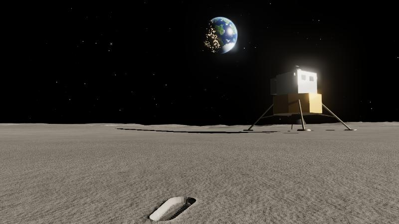
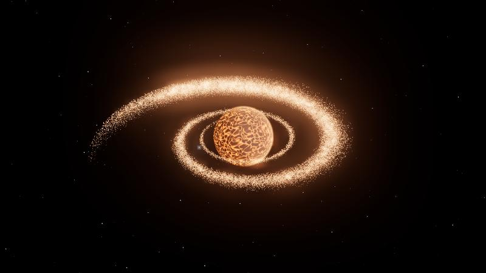
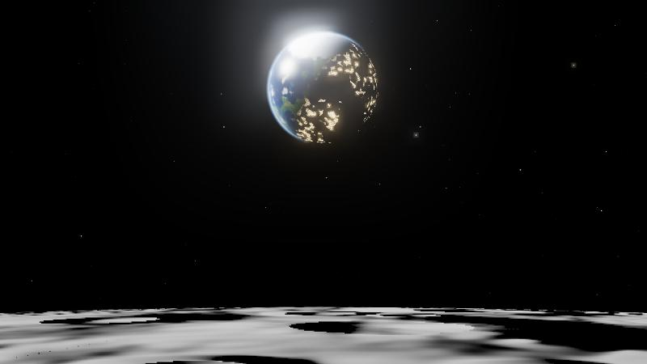
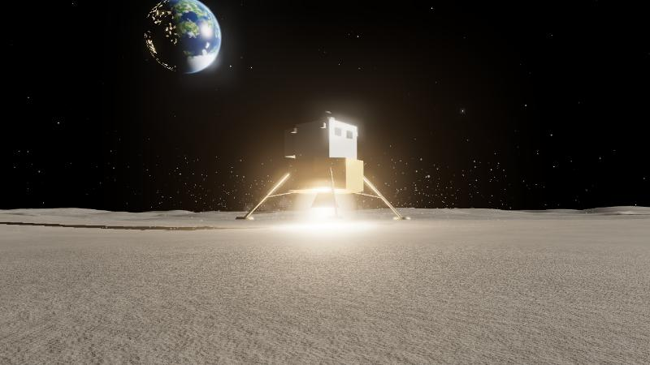
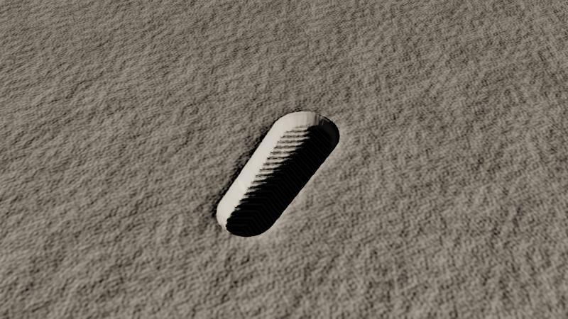

<h1 align="center">The Waiting Moon</h1>

<p align="center"><b>English</b> | <a href="README.ja.md">日本語</a></p>

<p align="center">
  <b>A 4.5-billion-year one-sided love, told by the Moon.<br>
  A five-minute Three.js film that plays in the browser. No dialogue. Only light, particles and music.</b>
</p>

<p align="center">
  <a href="https://futurecortexlabs.github.io/FCTX-Waiting-Moon/"><b>▶ Watch it</b></a>
  &nbsp;·&nbsp;
  <a href="#how-it-works">How it works</a>
  &nbsp;·&nbsp;
  <a href="#known-limits">Known limits</a>
</p>

<p align="center">
  
</p>

<p align="center">
  <sub>
  The last scene. The ship has gone home; only the footprint stays. With no wind on the Moon, it will last for more than a hundred million years.
  </sub>
</p>

---

## What it is

The hero is the Moon itself. From the middle of the film onwards, the camera stays on its surface and keeps watching the Earth.

Every fact it rests on is true:

- The Moon formed 4.5 billion years ago from debris thrown out when a planet-sized body struck the young Earth.
- Tidal locking means it always turns the same face to the Earth.
- It drifts about 3.8 cm further from the Earth every year.
- There is no wind on the Moon, so human footprints will last for more than a hundred million years.

The only words on screen are the last line and the title:

> 月は今も、年に3.8cmずつ遠ざかりながら、同じ顔を地球に向けている
> *(Even now, drifting away 3.8 cm a year, the Moon turns the same face to the Earth.)*

| Time | Scene | What happens |
|:--|:--|:--|
| 0:00–0:50 | **Birth** | A Mars-sized body grazes the molten Earth. The debris swirls into a disk and gathers into a red Moon, huge and close |
| 0:50–1:40 | **Facing** | The Moon cools to grey. The camera lands on its surface; the spin slows and stops, and the Earth halts in the sky. The Earth cools to blue and slowly shrinks |
| 1:40–2:30 | **Watching** | Green, ice, green again. Continents drift, the sea bulges towards the Moon, and fires then cities light the night side |
| 2:30–3:30 | **Spark** | A spark leaves the Earth's edge and heads straight here. It grows, opens its legs, and lands in slowly falling dust |
| 3:30–4:20 | **Footprint** | A boot sinks into the soil: the first footprint. The gaze lifts to the Earth, and a gloved hand rests on the ground |
| 4:20–5:00 | **Remain** | The ship leaves, and its spark is swallowed by the Earth. Only the footprint remains. The last line, darkness, the title |

<table>
<tr>
<td width="50%"></td>
<td width="50%"></td>
</tr>
<tr>
<td></td>
<td></td>
</tr>
</table>

---

## Watch it

- **Online:** [futurecortexlabs.github.io/FCTX-Waiting-Moon](https://futurecortexlabs.github.io/FCTX-Waiting-Moon/). The NASA textures and the score are in the repository, so the hosted copy is the full film.
- **Locally:** needs Node.js 24 ([`.nvmrc`](.nvmrc)).

  ```bash
  npm install
  npm run dev      # opens http://localhost:5173
  ```

It starts by itself and plays to the end. Browsers only allow sound after a user gesture, so click or press a key once; the music joins at the current position.

| Key | |
|:--|:--|
| `Space` | Pause / resume |

### Debug queries

| Query | Meaning |
|:--|:--|
| `?scene=footprint&t=30` | Start 30 s into the scene `footprint` |
| `?t=123` | Start 123 s into the whole film |
| `?debug` | Time slider (lil-gui), scene jump, fps |
| `?q=low` | Lighter mode: fewer particles, lower resolution, no MSAA |
| `?mute` | Do not load the music |
| `?paused` | Open paused |

Scene names: `birth` (0:00), `lock` (0:50), `watch` (1:40), `spark` (2:30), `footprint` (3:30), `remain` (4:20).

### Assets

All three are in the repository. The film still plays to the end without them: the Earth falls back to procedural shading and the film runs silent.

| Path | What |
|:--|:--|
| `public/textures/earth_day.jpg` | NASA Blue Marble: Next Generation, December 2004 (5400×2700). Used for the modern Earth |
| `public/textures/earth_night.jpg` | NASA Black Marble 2016, reduced to 5400×2700 with the land background removed so only the lights remain. City lights on the night side |
| `public/audio/music.mp3` | The five-minute score, synthesised by [`scripts/compose.mjs`](scripts/compose.mjs) (`npm run music`). While it plays, its position is the film's clock |

Details in [`public/textures/README.md`](public/textures/README.md) and [`public/audio/README.md`](public/audio/README.md).

---

## How it works

Vite + TypeScript + Three.js r180. One GSAP timeline holds the whole film.

```
every frame
  |
  +- clock      music position if it is playing, otherwise wall time
  +- timeline   gsap master.time(t) -> era, moonDist, moonHeat, tide, fade, line, title, bloom
  +- director   label lookup -> dispose old scene / setup new scene -> scene.update(local t)
  +- stage      space (Earth radius = 1) or surface (1 = 1 m), logarithmic depth buffer
  +- render     EffectComposer: RenderPass -> UnrealBloomPass -> OutputPass (ACES)
```

Every scene is a pure function of time, so `?scene=` and the debug slider can jump anywhere and see the same frame as in playback.

### One Earth, one uniform

`Earth` is a single class whose shader blends every age from one `uniform float era` (0 to 1): lava with glowing cracks, cooled rock, a steam-clouded ocean world, barren continents, green, an ice age reaching towards the equator, green again, the modern Earth (Blue Marble), first fires, then city lights (Black Marble) that switch on brightest-first and spread. Continents drift by sliding the noise domain. A Fresnel rim and a separate atmosphere shell give the limb glow.

### Tides seen from the Moon

The ocean shell is pushed out towards the Moon in the vertex shader by a few percent (P2 shape, so the far side bulges too). Seen from the Moon the bulge points straight at the camera, so the fragment shader also raises the sea level under it: coastlines flood as continents rotate through the bulge.

### Tidal locking

The camera rides an anchor on the Moon's surface, 75° from the sub-Earth point, so the horizon stays in frame. While the Moon still spins, the Earth sweeps across the sky; the residual spin eases to zero and the Earth comes to rest above the horizon at 1:32.

### The footprint

The ground around the footprint is a `PlaneGeometry` with a 1024² float height map (`DataTexture`), used as a displacement map. The boot sole is a signed-distance shape shared by the boot mesh and the print. The print gets sloped walls, chevron tread and a raised rim of pushed-out soil. The fragment shader rebuilds the normal from the height map, so the low sun throws shadows into the print. The print's profile is computed once; each frame only scales it by how far the boot has sunk.

### Low-gravity dust

Every grain follows `p = p0 + v·t − ½·1.62·t²` in the vertex shader, ending where it meets the ground. There is no air, so it does not hang; it arcs and falls slowly.

### People

Only boots and gloves appear. No faces, no bodies.

---

## Verification

Checked in Chromium (the Claude desktop app's built-in browser):

- `npm run typecheck` and `npm run build` pass.
- Every scene was rendered and inspected at several times.
- The whole film was stepped from 0 to 300 s at 0.1 s steps, twice, crossing every scene boundary, with no exceptions.
- With the NASA textures and the score in place, the film was played once from 0 to 300 s in real time, with the music as the clock. Every scene switched on time, the frame rate never fell below 59 fps (including the first switch to the lunar surface), the picture stayed within 21 ms of the music, and it ended on the title with no console errors.
- The score was checked as a waveform and spectrogram: no clipping and no clicks.

The screenshots in this README come from that check. There is no automated test suite.

---

## Performance

| | |
|:--|:--|
| Frame time | 0.4–2 ms per frame at 1024 × 768 on the GPU above, heaviest in Birth (60,000 particles) |
| Mid-range GPUs | Not measured yet. `?q=low` cuts particles to 24,000, caps the pixel ratio at 1 and turns off MSAA |
| Bundle | About 705 KB of JavaScript (195 KB gzipped), mostly Three.js |

---

## Known limits

- **The first switch to the lunar surface stalls once.** At 2:30, roughly 0.2 s on the GPU above, while the screen is fully black. With music playing, the picture catches up to the music afterwards.
- **The Moon's ground is soft up close in Facing and Watching.** The craters are procedural bump shading on a sphere, not geometry.
- **Sound needs one click or key press.** That is the browser's autoplay rule.

---

## Repository

| Path | Contents |
|:--|:--|
| [`src/main.ts`](src/main.ts) | Start-up, queries, render loop |
| [`src/core/`](src/core) | Master timeline (`timeline.ts`), parameters, director, post-processing, music clock, overlay text, debug GUI |
| [`src/scenes/`](src/scenes) | `birth`, `lock`, `watch`, `spark`, `footprint`, `remain`, each with `setup()`, `update(t)` and `dispose()` |
| [`src/world/`](src/world) | Earth, Moon, the two stages, terrain, footprint patch, lander, boots and gloves, dust, stars |
| [`src/shaders/`](src/shaders) | Simplex noise and the shared regolith shading |
| [`public/`](public) | NASA textures and the score |
| [`scripts/compose.mjs`](scripts/compose.mjs) | Composes and renders the score to `public/audio/music.mp3` |
| [`docs/media/`](docs/media) | The screenshots used in this README |
| [`CLAUDE.md`](CLAUDE.md) | The production spec (Japanese) |
| [`README.ja.md`](README.ja.md) | This README in Japanese |

---

## Licence

[Apache License 2.0](LICENSE). See [`NOTICE`](NOTICE) for the bundled libraries (Three.js, GSAP, lil-gui).
